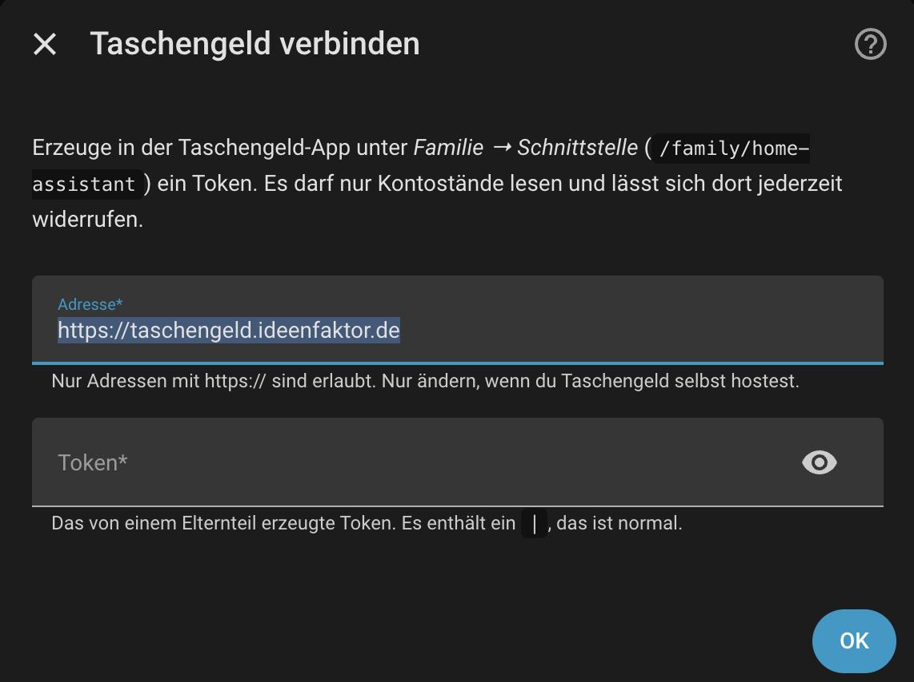
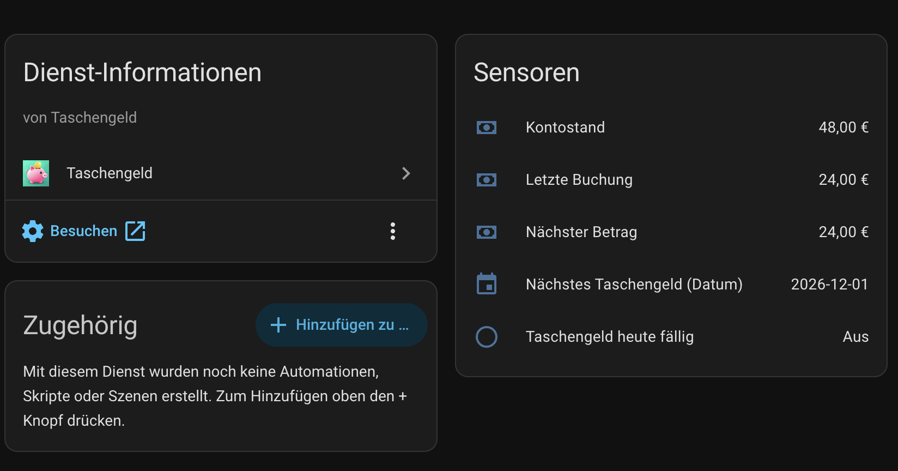

# Taschengeld für Home Assistant

Eine Home-Assistant-Integration (über [HACS](https://hacs.xyz) installierbar), die die Kontostände deiner Kinder aus dem
Dienst **Taschengeld** als Sensoren bereitstellt. Sie **liest nur** – sie bucht nie, ändert keine Kinder und keine Regeln.

> Version `1.0.0`.

## Einrichtung in 5 Schritten

1. In der Taschengeld-App als Elternteil unter **Familie → Schnittstelle** ein Token erzeugen und kopieren.
2. In HACS dieses Repository als *Benutzerdefiniertes Repository* (Kategorie *Integration*) hinzufügen und **Taschengeld** installieren.
3. Home Assistant neu starten.
4. **Einstellungen → Geräte & Dienste → Integration hinzufügen → Taschengeld**.
5. Adresse (Standard `https://taschengeld.ideenfaktor.de`, nur `https://`) und Token eintragen.

Das Token darf nur Kontostände lesen und lässt sich in der App jederzeit widerrufen. Kinder-Tokens funktionieren nicht.



## Entitäten

Pro Kind entsteht ein Gerät **„Taschengeld Mia“**:

| Entität | Typ | Hinweis |
|---|---|---|
| Kontostand | Sensor, `monetary`, EUR | `state_class: total` |
| Letzte Buchung | Sensor, `monetary` | Attribute `note` (Notiz) und `booked_at` (Zeitpunkt) |
| Nächstes Taschengeld (Datum) | Sensor, `date` | leer, wenn keine aktive Regel existiert |
| Nächster Betrag | Sensor, `monetary` | leer, wenn keine aktive Regel existiert |
| Taschengeld heute fällig | Binärsensor | an, solange das nächste Datum der heutige Tag ist |

Kinder, die in Taschengeld dazukommen oder verschwinden, erscheinen bzw. verschwinden automatisch.

Geräteseite (Dienst-Informationen und Sensoren):



Dashboard-Karte (Kachel mit dem Kontostand):


„Heute fällig“ bleibt an, bis die nächste Abfrage das neue Datum liefert (spätestens bei der nächsten geplanten Abfrage).

## Abfragezeiten

Standard: **einmal täglich um 07:00 Uhr** (Ortszeit von Home Assistant). Unter *Konfigurieren* stellst du ein:

- **Abfrageintervall:** alle 6, 8, 12 Stunden oder einmal täglich (24 Stunden).
- **Startzeit:** die Uhrzeit der ersten Abfrage des Tages. Die weiteren Abfragen folgen im gewählten Abstand, jeden Tag zu denselben Uhrzeiten.
  Beispiel: Startzeit 06:00 und alle 8 Stunden ergibt 06:00, 14:00 und 22:00 Uhr.

**Zufälliger Versatz:** Zur Entlastung des Servers addiert jede Installation einmalig einen festen, zufälligen Versatz von
0 bis 180 Minuten auf die Startzeit. Bei Startzeit 07:00 liegt die tägliche Abfrage also irgendwo zwischen 07:00 und 10:00 Uhr,
bei dir aber jeden Tag zur selben Uhrzeit. Der Wert wird bei der Einrichtung gewürfelt und bleibt danach gleich.

Beim Start von Home Assistant und nach dem Speichern der Optionen wird einmal sofort abgefragt. Es wird ein einziger Aufruf für
alle Kinder gemacht, und zwei Aufrufe liegen immer mindestens 30 Minuten auseinander (auch bei manuellem Aktualisieren).
Schlägt eine Abfrage fehl, wird nach einer Stunde erneut versucht. Bei „zu viele Anfragen“ (429) oder Wartung (503) wartet die
Integration mindestens so lange, wie der Dienst über `Retry-After` verlangt.

## Beispiel-Dashboard

```yaml
type: entities
title: Taschengeld
entities:
  - entity: sensor.taschengeld_mia_balance
    name: Mia
  - entity: sensor.taschengeld_ben_balance
    name: Ben
```

Mit Detailkarte pro Kind:

```yaml
type: vertical-stack
cards:
  - type: tile
    entity: sensor.taschengeld_mia_balance
    name: Mia
  - type: entities
    entities:
      - entity: sensor.taschengeld_mia_last_booking
      - entity: sensor.taschengeld_mia_next_allowance_date
      - entity: sensor.taschengeld_mia_next_allowance_amount
```

## Beispiel-Automation

Benachrichtigung, wenn der Kontostand unter 1 € fällt:

```yaml
alias: Taschengeld Mia fast leer
triggers:
  - trigger: numeric_state
    entity_id: sensor.taschengeld_mia_balance
    below: 1
actions:
  - action: notify.notify
    data:
      title: Taschengeld
      message: "Mias Kontostand ist unter 1 € ({{ states('sensor.taschengeld_mia_balance') }} €)."
```

(Die Entitäts-IDs hängen vom Namen des Kindes ab; schau sie auf der Geräteseite nach.)

## Fehlerbehebung

| Meldung | Bedeutung |
|---|---|
| Token ungültig oder widerrufen | Neues Token in der App erzeugen. Home Assistant fragt bei einem späteren 401 automatisch danach (Reauth). |
| Token darf keine Kontostände lesen | Es wurde ein Kinder-Token oder ein Token ohne Recht `ha:read` verwendet. |
| Nicht erreichbar | Adresse und Internetverbindung prüfen. |
| Zu viele Anfragen / Wartung | Der Dienst bremst. Nichts tun, die Integration versucht es später erneut. |

Diagnose: *Gerät → ⋮ → Diagnose herunterladen*. Token, Adresse, Namen, Kürzel und Notizen sind darin geschwärzt.

## Datenschutz

Die Integration spricht ausschließlich mit der eingetragenen Adresse, folgt keinen Weiterleitungen, sendet keine Telemetrie und
schreibt das Token nie ins Protokoll.

## Entwicklung

```bash
python -m venv .venv && . .venv/bin/activate     # Python >= 3.14 (Home Assistant 2026.x)
pip install -r requirements_test.txt
pytest
ruff check .
```

Das Icon liegt in `custom_components/taschengeld/brand/` (`icon.png` 256×256, `icon@2x.png` 512×512).

---

# Taschengeld for Home Assistant

A Home Assistant integration (installable via [HACS](https://hacs.xyz)) that exposes your children's balances from the
**Taschengeld** service as sensors. It is **read-only**: it never books, and never changes children or rules.

> Version `1.0.0`.

## Setup in 5 steps

1. In the Taschengeld app (as a parent) create a token under **Family → Interface**.
2. In HACS add this repository as a *custom repository* (category *Integration*) and install **Taschengeld**.
3. Restart Home Assistant.
4. **Settings → Devices & services → Add integration → Taschengeld**.
5. Enter the address (default `https://taschengeld.ideenfaktor.de`, https only) and the token.


## Entities

One device per child ("Taschengeld Mia"): **Balance** (monetary, EUR, `total`), **Last booking** (monetary, attributes
`note` and `booked_at`), **Next allowance (date)**, **Next allowance (amount)** and the binary sensor **Allowance due today**.
Children that appear or disappear in Taschengeld are added or removed automatically.


## Polling schedule

Default: **once a day at 07:00** (Home Assistant's local time). In the options you choose an interval of 6, 8, 12 or 24 hours
and a start time; polls then happen at the start time plus multiples of the interval, every day at the same clock times
(for example 06:00 and every 8 hours: 06:00, 14:00, 22:00). To spare the server, each installation adds a fixed random delay of 0 to 180 minutes to the start time, chosen once at setup. One request serves all children, requests are at least 30 minutes
apart, a failed poll is retried after an hour, and on HTTP 429/503 the integration waits at least as long as the service's
`Retry-After` header demands. On HTTP 401 Home Assistant asks for a new token (reauth) instead of removing the integration.

## Troubleshooting & privacy

See the German section above for the dashboard and automation examples (entity IDs depend on the child's name). Diagnostics
redact the token, address, names, slugs and notes. The integration only talks to the configured address, does not follow
redirects, sends no telemetry and never logs the token.
